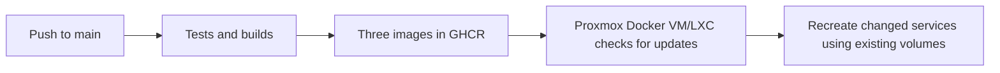

# Registry images and automatic updates

GitHub Actions builds the application, Telegram worker and pose service and publishes them to GitHub Container Registry (GHCR). A timer on the Linux VM/LXC running Docker pulls new images every five minutes. No inbound deployment port or SSH access from GitHub is required.



## Publish the first images

Commit the reviewed source changes, including `.github/workflows/images.yml`, and push to the repository's `main` branch. In **GitHub → Actions → Test and publish images**, wait for `checks`, all three `build` jobs and `promote` to finish.

The workflow uses GitHub's built-in `GITHUB_TOKEN` with `packages: write`; no personal publishing token is required in repository secrets. Repository or organization policies must allow GitHub Actions and the workflow's package permissions. See [GitHub's GHCR publishing guide](https://docs.github.com/en/packages/managing-github-packages-using-github-actions-workflows/publishing-and-installing-a-package-with-github-actions).

For a repository named `OWNER/REPOSITORY`, images are named using lowercase values:

| Image | Purpose |
| --- | --- |
| `ghcr.io/owner/repository-app:latest` | Web application and API |
| `ghcr.io/owner/repository-telegram:latest` | Telegram input worker |
| `ghcr.io/owner/repository-pose:latest` | Local photo analysis |

Each image also receives `sha-FULL_GIT_COMMIT` for a specific source revision. Builds target `linux/amd64`, suitable for an x86 Proxmox Docker host. Pull requests run checks without publishing images. Manual workflow runs publish only when the selected branch is `main`.

All three images must build successfully before the workflow promotes any `latest` tags. Registry tags are promoted sequentially; the updater rejects mixed source revisions during that brief window and retries at its next run.

Published images exclude local `.env` files, databases, photos, historical seed records and test fixtures. Existing deployment volumes keep their records. Fresh deployments start with an empty journal. This image boundary does not sanitize tracked source files or Git history; see [publication privacy](privacy.md).

## One-time setup on the Docker host

Run these steps inside the VM/LXC where Docker is installed, rather than on the Proxmox hypervisor. The host needs Docker Engine, Docker Compose v2.20 or newer, Bash, Python 3, `flock` and systemd. Use the same server account for manual Docker commands and registry login as the updater; the installer uses root.

### Get the deployment files

Update the existing checkout on the server after committing and pushing the changes:

```sh
cd /path/to/existing/checkout
git pull --ff-only
```

If the server has only a copied directory, clone the repository once into a deployment directory. GitHub's **Code** menu provides the clone URL. A private repository needs Git authentication separately from the registry login below. Future application-code updates arrive as images; the server does not need to build them or pull source on each timer run.

Keep the current `.env` private and make a local backup before editing it:

```sh
cp .env .env.before-images
chmod 600 .env .env.before-images
```

### Preserve the existing journal and bot volumes

Find the existing Compose project and exact data-volume names before switching:

```sh
docker compose ls
docker compose ps -a
docker volume ls
```

To confirm a container's mounted volumes, substitute its ID:

```sh
docker inspect --format '{{range .Mounts}}{{println .Destination .Name}}{{end}}' CONTAINER_ID
```

The application uses `/data`; Telegram uses `/bot-data`. Merge settings from [production.env.example](../deploy/production.env.example) into the server's **existing** `.env`. Preserve the bot token, allowed user/group IDs and Stride API token. Add these settings, replacing placeholders with the deployment's real values:

```dotenv
COMPOSE_PROJECT_NAME=EXISTING_COMPOSE_PROJECT_NAME
IMAGE_REPOSITORY=ghcr.io/owner/repository
IMAGE_TAG=latest
STRIDE_DATA_VOLUME=EXACT_EXISTING_JOURNAL_VOLUME
TELEGRAM_DATA_VOLUME=EXACT_EXISTING_BOT_VOLUME
COMPOSE_PROFILES=pose,telegram
```

Use the same Compose project name as the old deployment so that its containers are replaced. Changing the project name can launch a second Telegram worker. Keep the same exposed port, bind address and other server settings. `TELEGRAM_ALLOWED_GROUP_ID` remains a server-local `.env` setting; it is not embedded in the images.

The production Compose file uses external volumes and refuses to create replacements when the specified volumes are missing. The updater also rejects a volume setting that differs from an existing container's mount in the same project. Do not remove or recreate the volumes when switching to images. Keep a private, current backup using the [backup instructions](../README.md#storage-and-backups).

For a genuinely new deployment, explicitly create the intended volumes once with `docker volume create VOLUME_NAME`. Existing deployments should reuse their existing volumes.

### Log in to GHCR

New GHCR packages are private by default. For private images, create a GitHub **personal access token (classic)** with `read:packages` and access to the packages. Log in as root so the systemd worker can use the credentials:

```sh
sudo docker login ghcr.io --username YOUR_GITHUB_USERNAME
```

Paste the token at the password prompt; do not put it in Compose, a command argument, GitHub source or `.env`. Public GHCR images allow anonymous pulls and do not need this login. Package visibility is controlled separately in GitHub package settings. See [GHCR authentication and visibility](https://docs.github.com/en/packages/working-with-a-github-packages-registry/working-with-the-container-registry).

### Run the first image deployment

From the deployment directory:

```sh
sudo env STRIDE_DEPLOY_DIR="$PWD" bash deploy/update.sh
sudo docker compose -f compose.production.yaml ps
```

The updater pulls all enabled images, checks their source revisions, and runs Compose with `--no-build --pull never --wait`. Compose recreates services whose images or configuration changed. Existing journal and Telegram volumes remain mounted. The web app and enabled pose service must pass their Docker health checks; the Telegram worker must remain running. Inspect its logs separately to verify Telegram connectivity.

Only the Proxmox worker should use the live bot token. Leave any development-machine worker stopped. Repeated Telegram polling HTTP 409 errors usually indicate another polling worker using the same token.

### Enable automatic updates

Once the first image deployment works:

```sh
sudo bash deploy/install-auto-update.sh "$PWD"
sudo systemctl list-timers stride-update.timer
```

The installer places the updater in `/usr/local/lib/stride/`, records the deployment directory in `/etc/stride-updater.conf`, and enables a systemd timer. It checks for releases about every five minutes, including after reboots. It uses outbound registry access; no GitHub SSH credentials or inbound webhook are needed. Your normal development cycle becomes:

```sh
git add SPECIFIC_FILES_YOU_REVIEWED
git commit -m "Describe the change"
git push origin main
```

After tests, builds and promotion finish, Proxmox pulls the new release at the next check. If image pulls fail or revisions differ, the updater leaves running containers alone. It holds a local lock to prevent overlapping runs. An unhealthy deployment is reported as failed; the updater does not automatically reverse database changes.

The timer updates container images and reconciles existing local settings. Changes to Compose files, the updater itself, new required environment variables or systemd units still require a deliberate server configuration update. Pull those files from Git and rerun the installer when necessary.

## Monitoring, manual updates and rollback

Inspect updater runs and application state:

```sh
sudo journalctl -u stride-update.service -n 100 --no-pager
sudo docker compose -f compose.production.yaml ps
sudo docker compose -f compose.production.yaml logs --tail=50 telegram
```

Trigger an immediate update:

```sh
sudo systemctl start stride-update.service
```

Pause updates:

```sh
sudo systemctl disable --now stride-update.timer
```

This stops future scheduled checks. If a deployment is already running, inspect it with `systemctl status stride-update.service` and let it finish before making manual changes.

Before replacing a labeled application image, the updater records its source revision in `.deploy-state/previous-release`. The last successful revision is in `.deploy-state/current-release`. A first migration from a locally built image may have no previous revision label; retain that local image and a private backup until the migration is verified. The updater does not prune images or volumes.

For rollback, pause the timer, check that the previous version supports the current database, and set the server's `.env` to `IMAGE_TAG=sha-FULL_PREVIOUS_COMMIT`. Then rerun:

```sh
sudo systemctl start stride-update.service
```

All services use the same pinned revision. Keep the tag pinned until ready to resume tracking `latest`. An image rollback does not restore the database; use a compatible backup if a schema change requires a data restore.

For troubleshooting `unauthorized` pulls, check root's registry login and package access. Missing manifests mean the first publish has not completed, the image prefix is wrong, or the selected SHA was not published. A revision mismatch can occur during promotion or after a partially failed promotion; inspect the GitHub Actions run before retrying.
